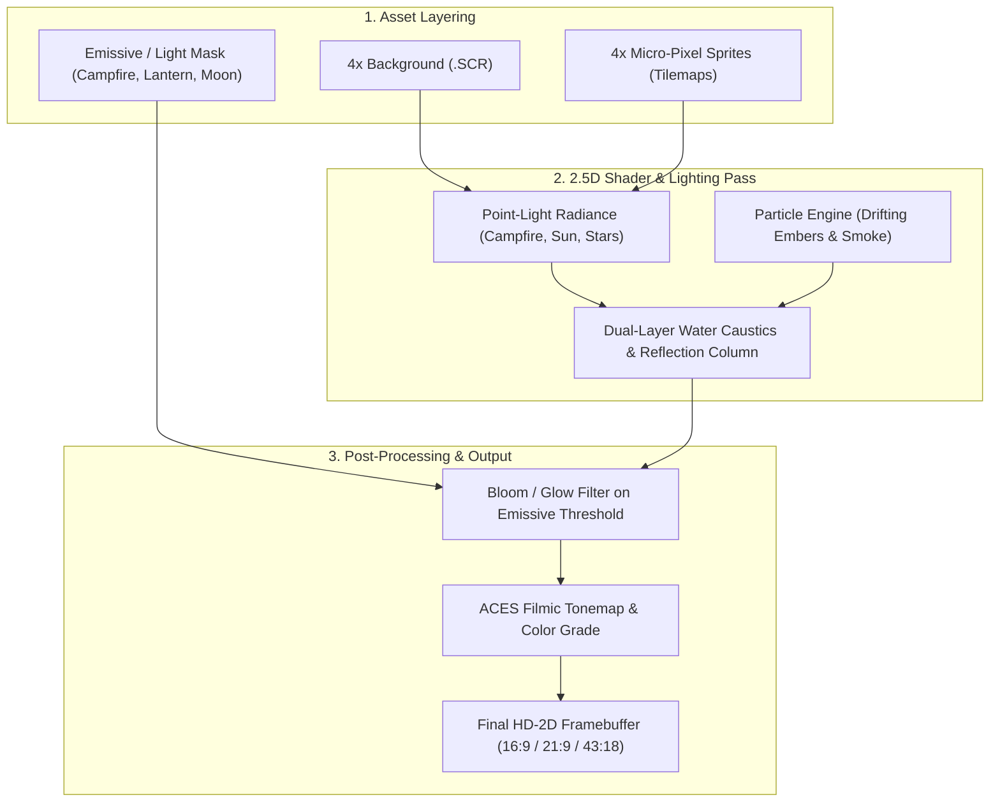

# Screen Antics: Johnny Castaway — Modern HD-2D Neo-Retro Technical Specification

This document provides complete technical, visual, and shader specifications for Codex to implement the **Modern HD-2D Neo-Retro** art direction (selected by the user based on Style 4: *Sea of Stars* / *Octopath Traveler*).

Visual Target Reference:
- **Master Concept Art**: [`modern_ai_style4_hd2d.jpg`](file:///home/gmuller/.gemini/antigravity/brain/8aee4f8c-cdb9-4096-aef7-ec5d4fc3c922/modern_ai_style4_hd2d.jpg)
- **4-Style Comparison Board**: [`modern_ai_concepts_showcase.jpg`](file:///home/gmuller/.gemini/antigravity/brain/8aee4f8c-cdb9-4096-aef7-ec5d4fc3c922/modern_ai_concepts_showcase.jpg)

---

## 1. Visual Philosophy & Core Aesthetic

The **Modern HD-2D Neo-Retro** direction bridges nostalgic 16-bit/32-bit pixel art craftsmanship with modern 2.5D atmospheric rendering:
1. **High-Density Micro-Pixel Sprites**:
   - Replaces coarse 1992 EGA/VGA checkerboard dither patterns with clean 24-bit/32-bit sub-pixel character and scenery detailing.
   - Johnny Castaway is rendered with rich anatomical shading, frayed cut-off denim shorts, wind-blown scruffy beard and hair strands, and expressive comedic/emotional keyframes.
2. **Dynamic Volumetric Lighting**:
   - Golden-hour sunbeams and atmospheric haze piercing through cloud banks.
   - Point-light campfire radiance that dynamically illuminates the sand, Johnny's skin, and nearby props.
3. **Multi-Layered Water & Caustics**:
   - Layered translucent turquoise-to-deep-indigo lagoon water.
   - Animated procedural water caustics reflecting sunlight and firelight.
   - Gently breaking pixel foam along the island shoreline.
4. **Particle Effects**:
   - Real-time rising fire embers with subtle physics turbulence.
   - Soft curling smoke plumes and floating sea spray particles.

---

## 2. HD-2D Rendering Pipeline Architecture



---

## 3. Sprite Tilemap & Manifest Guidelines for Codex

### A. Resolution & Grid Registration
- **Scale Factor**: Exact `4x` integer scale from native 1x coordinates.
- **Manifest Directory**: [`remaster-handoff/context/sprite-manifests/<STEM>.json`](file:///home/gmuller/.gemini/antigravity/scratch/screen-antics-remaster/remaster-handoff/context/sprite-manifests)
- **Grid Layout**: All frames must be placed strictly at their specified `rect: [x, y, w, h]` within each sheet's `canvas_size`.
- **Transparency**: Fully transparent background (`RGBA`, `A = 0`) around sprite silhouettes; no stray matte borders or fringing.

### B. Micro-Pixel Artistry Guidelines
- **Palette Depth**: 24-bit RGB with full alpha channel.
- **Outlines**: Dark, warm selective outlines (deep umber/navy rather than harsh pure black) to integrate naturally with atmospheric lighting.
- **Highlighting**: Warm rim highlights on the sunward side (top/left) and warm amber bounce light on surfaces facing the campfire.

---

## 4. Background & Widescreen Specifications

### A. Core Backgrounds (10 Files)
- Location: [`remaster-handoff/edited/backgrounds/*.SCR.png`](file:///home/gmuller/.gemini/antigravity/scratch/screen-antics-remaster/remaster-handoff/edited/backgrounds)
- Resolution: Exact 4x `runtime_size` (`2560x1920` or `2560x1400`), 100% opaque (`RGBA`, `A = 255`).
- Landmarks:
  - `ISLAND2.SCR`: Horizon locked to `y = 740`, sandbar bounds `(36..1192, 1116..1328)`.
  - `ISLETEMP.SCR`: Sandbar shifted right by exact `dx = +1088px`.
  - `NIGHT.SCR`: Horizon locked to `y = 820`, moon center at `(cx = 662, cy = 342)`.
  - `OCEAN00..02.SCR`: Sky horizon `y = 640`, water surface meniscus `y = 760`.

### B. Widescreen Variants (30 Files)
- Location: [`remaster-handoff/edited/widescreen/{16_9,21_9,43_18}/*.SCR.png`](file:///home/gmuller/.gemini/antigravity/scratch/screen-antics-remaster/remaster-handoff/edited/widescreen)
- Invariant: `widescreen_im.crop(stage_rect_xywh) == core_im` byte-for-byte.
- Panoramic Scenes (`ISLAND2`, `ISLETEMP`, `NIGHT`, `OCEAN00..02`): Open-ocean and sky extensions across widescreen canvas margins without duplicating island or moon props.
- Framed Scenes (`INTRO`, `JOFFICE`, `SUZBEACH`, `THEEND`): Pure `(0, 0, 0)` exterior letterboxing outside the framed storyboards.

---

## 5. Runtime Shader & Engine Implementation Directives

When wiring the runtime screensaver/player in Rust/OpenGL/WGPU:

```rust
// Pseudocode for HD-2D Runtime Shader Parameters
pub struct HD2DLightConfig {
    pub campfire_pos_stage: [f32; 2],    // e.g. [1380.0, 1180.0] on ISLAND2 (4x)
    pub campfire_color: [f32; 3],        // [1.0, 0.72, 0.25] warm golden amber
    pub campfire_radius: f32,            // 320.0 px (4x scale)
    pub flicker_intensity: f32,          // 0.15 amplitude noise modulation
    pub sun_angle: f32,                  // ~45 degrees (golden hour rays)
    pub water_caustic_speed: f32,        // 0.4 Hz gentle wave ripple
    pub ember_particle_count: u32,       // 24 active floating embers
}
```

1. **Campfire Point Light**:
   - Radial quadratic falloff: `attenuation = 1.0 / (1.0 + 0.005 * dist + 0.00002 * dist * dist)`.
   - Modulate intensity using low-frequency Perlin noise to create natural fire flicker.
2. **Water Caustics**:
   - Dual-texture scrolling normal map blended across the ocean plane (`y >= horizon`).
   - Sunlight specular highlights glistening along wave crests.
3. **Bloom Pass**:
   - Downsample emissive layer (campfire flames, stars, moon corona, sunglasses gleam).
   - 2-pass Gaussian blur (radius: 12px) and additive blend over final scene.

---

## 6. Verification Command

Codex can verify full asset compliance at any time using:
```bash
python3 /home/gmuller/.gemini/antigravity/scratch/screen-antics-remaster/remaster-handoff/tools/validate_remaster_edits.py \
  --pack /home/gmuller/.gemini/antigravity/scratch/screen-antics-remaster/remaster-handoff \
  --edited /home/gmuller/.gemini/antigravity/scratch/screen-antics-remaster/remaster-handoff/edited
```
Expected output:
```json
{
  "ok": true,
  "checked": {
    "backgrounds": 10,
    "widescreen": 30,
    "sprite_tilemaps": 116,
    "audio": 23
  },
  "warnings": [],
  "errors": []
}
```
